# 最新实验记录进展

## 主实验：

V0： full_rbf 最最开始复现的一版，完全对照论文来实现：MDP设计 状态：(x,y,B1,B2,B3) 奖励：r = r_gp_local + r_mh + r_out + r_rep

V0.1： no_b_rbf 一个很小的对照版本; 只把V0 状态改为(x,y) 其余不变

V1： bnorm_no_mh_uncertain_rbf 改进的一大版本，MDP设计 状态:：(x,y,B1,B2,B3,+8维周围方差) // 采用Bmax归一化 ；奖励：r = r_gp_local +  r_out + r_rep 去掉r_mh // r_gp_local的附近评价4个点增加至8个点；

V1.1： bnorm_no_mh_rbf，V1 的五维状态对照版；状态为 (x,y,B1,B2,B3)，去掉八维周围方差输入，保留 V1 的分场景磁场归一化、八邻域局部 GP 奖励和其余参数。训练 seed=0，10000 回合，已完成。

V2： 又改进了一个大版本，MDP设计 状态:：(x,y,B1,B2,B3, +8维周围方差 + 9维九宫格地图方差表示) //  ；奖励：r = r_gp_local +  r_out + r_rep + r_gp_global // 新增了一项全局gp奖励；训练参数微调：update_epochs=10、训练seed=0/1/2

V2.1: 一个很小的对照版本; 只把V2 奖励去掉r_gp_local，剩下r_gp_global+其他；

## 结果展示：

RMSE [nT]和Trr [%]均越低越好。±为标准差

V0、V0.1 复用旧 seed=0 权重，原模型在 15×15 网格训练；本次仅在当前网格重测，保留原训练归一化（坐标除以 14），属于跨网格评估。V1.1 在祝融从头训练、毅力号监测；update_epochs=80，其余训练参数沿用 V1。V0、V0.1、V1、V1.1 各为 1 个训练 seed × 50 回合；V2 和 V2-GlobalOnly 各为 3 个训练 seed × 50 回合。150 回合共享 50 个测试起点，不代表 150 个独立起点。

V1/V2 复用原始评估数据，已核验地图模型哈希和评估配置一致。毅力号 V1 行已按其原始 CSV 更正。V1 与 V2 的比较同时包含状态、奖励和训练参数差异；V1 与 V1.1 为移除周围方差输入的对照。

### 祝融

| 方法           | 回合数 |        RMSE [nT] |           Trr [%] |
| -------------- | -----: | ---------------: | ----------------: |
| V0             |     50 | 2.6349 ± 0.4257 | 47.9565 ± 5.3239 |
| V0.1           |     50 | 2.0917 ± 0.4200 | 45.7058 ± 3.7914 |
| V1（版本参考） |     50 | 3.8169 ± 0.5594 | 45.0504 ± 2.6573 |
| V1.1           |     50 | 2.7832 ± 0.5693 | 47.8275 ± 3.2458 |
| V2             |    150 | 2.5416 ± 0.7316 | 33.3355 ± 2.9947 |
| V2-GlobalOnly  |    150 | 2.4751 ± 0.6563 | 33.0896 ± 2.6776 |

在线曲线为第 0 步起点采样后至第 70 步的均值，阴影为 ±1 个总体标准差；图例 n 表示评估回合数。

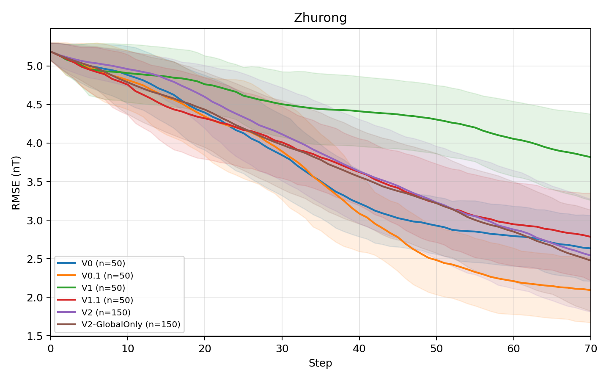

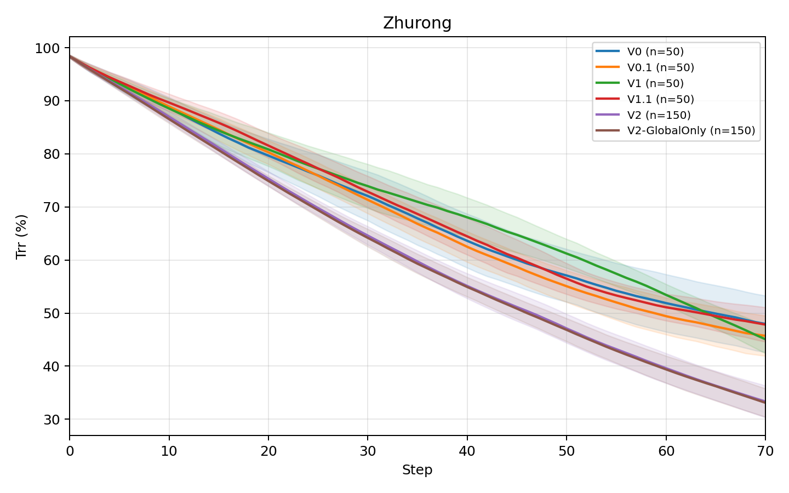

### 毅力号

| 方法           | 回合数 |         RMSE [nT] |            Trr [%] |
| -------------- | -----: | ----------------: | -----------------: |
| V0             |     50 | 14.8724 ± 3.7885 | 66.3756 ± 11.2346 |
| V0.1           |     50 |  4.8238 ± 3.6677 |  31.8165 ± 4.5948 |
| V1（版本参考） |     50 |  3.6363 ± 2.1879 |  28.3989 ± 3.9752 |
| V1.1           |     50 | 15.2259 ± 4.2561 |  51.2884 ± 8.7520 |
| V2             |    150 |  4.4797 ± 3.7693 |  21.7045 ± 4.6384 |
| V2-GlobalOnly  |    150 |  4.2545 ± 3.5181 |  20.4404 ± 4.1480 |

在线曲线为第 0 步起点采样后至第 70 步的均值，阴影为 ±1 个总体标准差；图例 n 表示评估回合数。

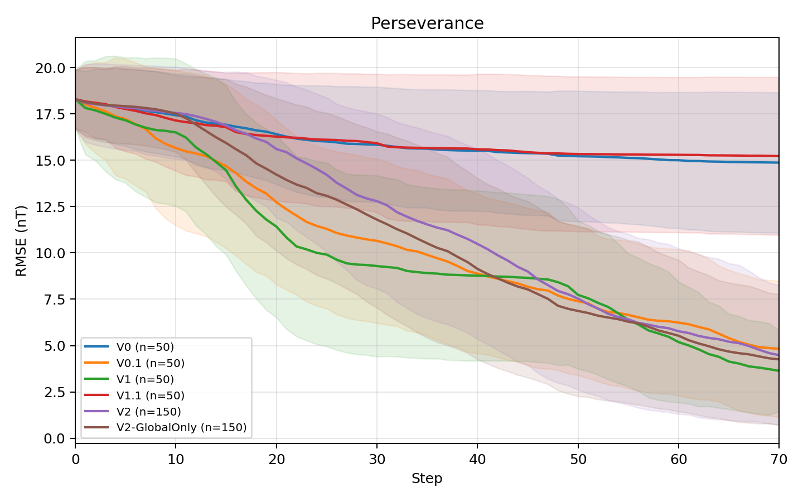

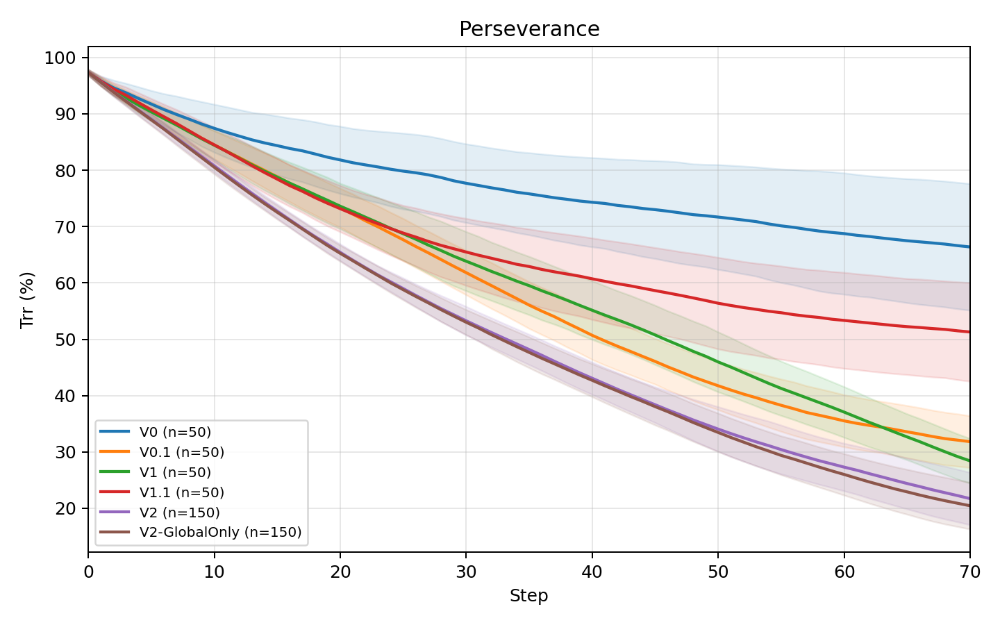

## 对比实验：

### 祝融

| 方法                       | 回合数 |        RMSE [nT] |            Trr [%] |
| -------------------------- | -----: | ---------------: | -----------------: |
| GP-Entropy Active Learning |     50 | 1.8701 ± 0.4424 |  34.0385 ± 3.1202 |
| GP-Trace Active Learning   |     50 | 1.9372 ± 0.5483 |  34.1844 ± 4.2647 |
| Msr                        |     50 | 1.6464 ± 0.6161 |  52.3564 ± 9.0514 |
| Cover                      |     50 | 2.9706 ± 0.5471 | 53.2631 ± 10.3931 |
| V2                         |    150 | 2.5416 ± 0.7316 |  33.3355 ± 2.9947 |
| V2-GlobalOnly              |    150 | 2.4751 ± 0.6563 |  33.0896 ± 2.6776 |

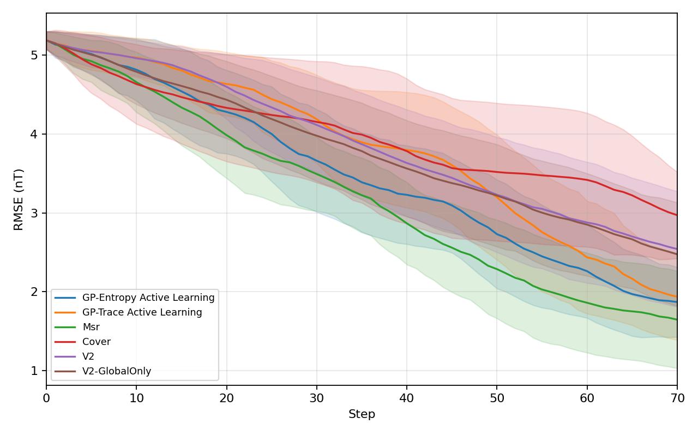
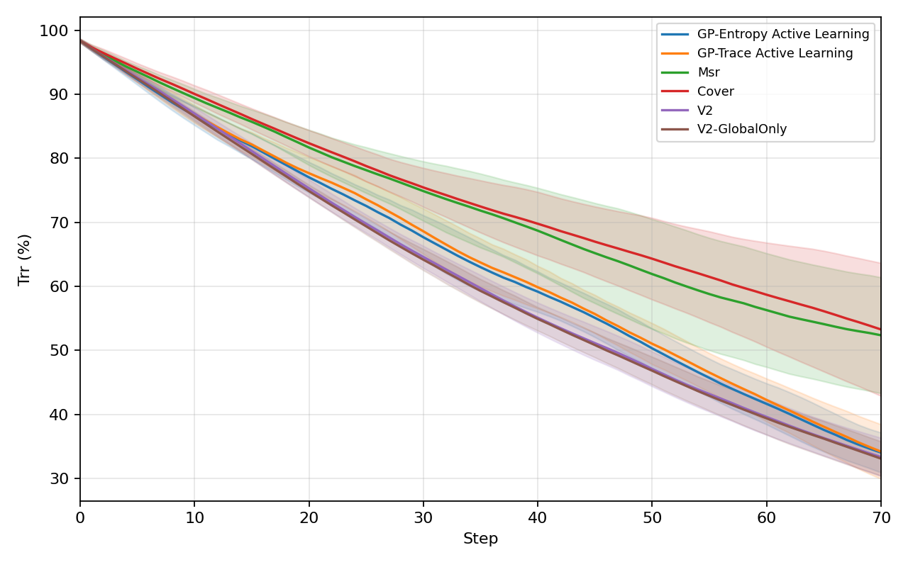

### 毅力号

| 方法                       | 回合数 |         RMSE [nT] |            Trr [%] |
| -------------------------- | -----: | ----------------: | -----------------: |
| GP-Entropy Active Learning |     50 |  3.1589 ± 1.6308 |  24.8608 ± 5.4071 |
| GP-Trace Active Learning   |     50 |  5.0588 ± 4.3390 |  27.9817 ± 4.5034 |
| Msr                        |     50 |  5.7576 ± 4.7305 | 40.0966 ± 11.5212 |
| Cover                      |     50 | 15.5487 ± 4.1918 | 46.5068 ± 11.7978 |
| V2                         |    150 |  4.4797 ± 3.7693 |  21.7045 ± 4.6384 |
| V2-GlobalOnly              |    150 |  4.2545 ± 3.5181 |  20.4404 ± 4.1480 |

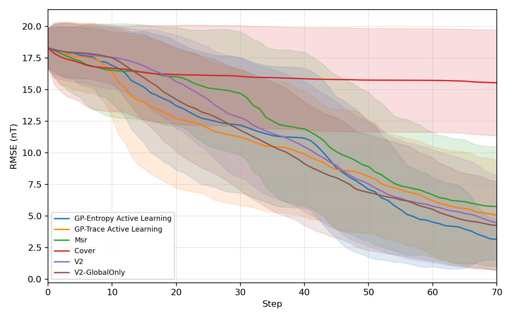
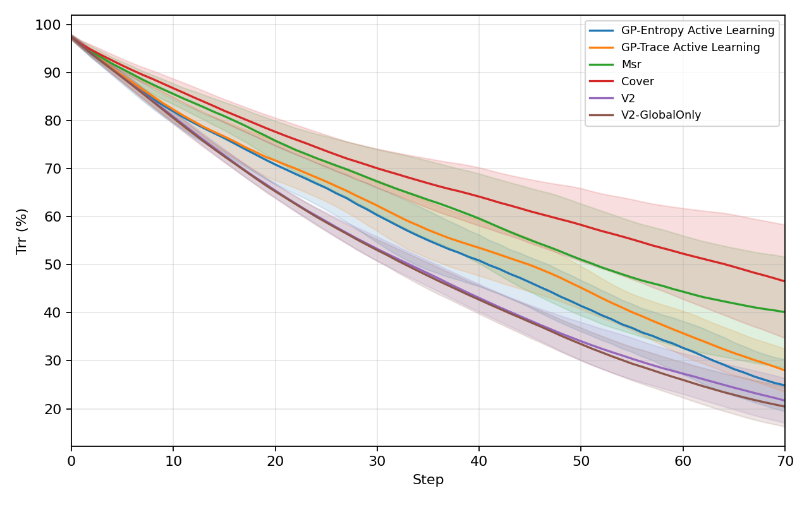

train1 对应祝融，test1 对应毅力号；上面的两张原地图结果保留。

### test2

| 方法                       | 回合数 |        RMSE [nT] |           Trr [%] |
| -------------------------- | -----: | ---------------: | ----------------: |
| GP-Entropy Active Learning |     50 | 3.2297 ± 0.2440 | 59.3479 ± 1.7143 |
| GP-Trace Active Learning   |     50 | 3.2189 ± 0.2605 | 58.8775 ± 1.5369 |
| Msr                        |     50 | 3.6566 ± 0.1810 | 69.9108 ± 5.2343 |
| Cover                      |     50 | 3.3430 ± 0.2915 | 68.1829 ± 6.9911 |
| V2                         |     50 | 3.7459 ± 0.2140 | 61.4198 ± 2.5284 |
| V2-GlobalOnly              |     50 | 3.5927 ± 0.2722 | 59.3948 ± 1.8624 |

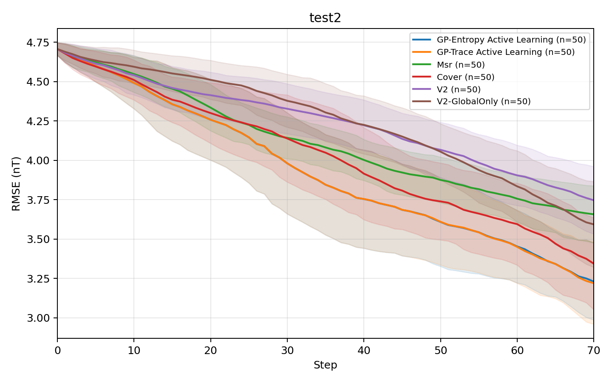

### test3

| 方法                       | 回合数 |        RMSE [nT] |           Trr [%] |
| -------------------------- | -----: | ---------------: | ----------------: |
| GP-Entropy Active Learning |     50 | 3.9972 ± 0.1313 | 80.3176 ± 0.3650 |
| GP-Trace Active Learning   |     50 | 3.9712 ± 0.1334 | 80.2021 ± 0.3138 |
| Msr                        |     50 | 3.9247 ± 0.1536 | 83.8887 ± 2.5569 |
| Cover                      |     50 | 3.8429 ± 0.1266 | 83.2842 ± 3.6059 |
| V2                         |     50 | 3.7785 ± 0.1801 | 82.6127 ± 2.5424 |
| V2-GlobalOnly              |     50 | 3.7818 ± 0.1772 | 81.4667 ± 1.4550 |

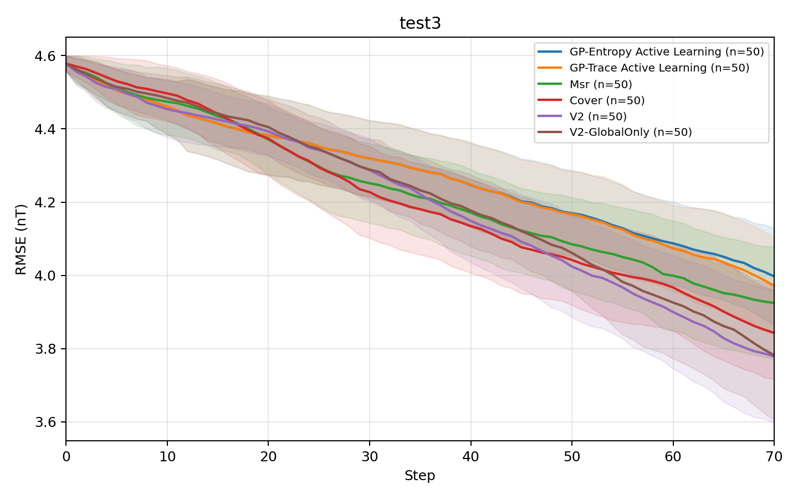

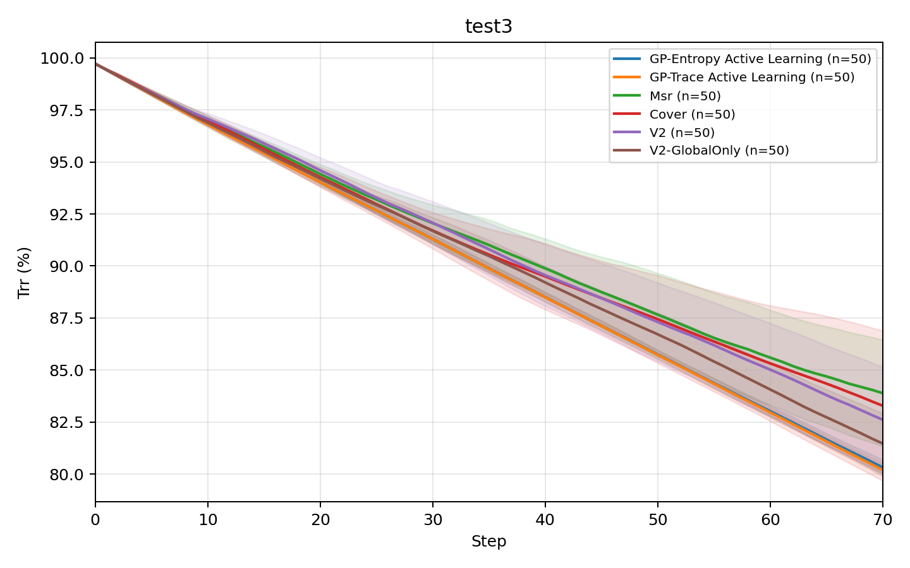

### test4

| 方法                       | 回合数 |        RMSE [nT] |           Trr [%] |
| -------------------------- | -----: | ---------------: | ----------------: |
| GP-Entropy Active Learning |     50 | 2.2060 ± 0.1294 | 78.7875 ± 0.4303 |
| GP-Trace Active Learning   |     50 | 2.2073 ± 0.1492 | 78.6375 ± 0.3689 |
| Msr                        |     50 | 2.2733 ± 0.1093 | 82.7892 ± 2.7478 |
| Cover                      |     50 | 2.3923 ± 0.1512 | 82.1057 ± 3.8666 |
| V2                         |     50 | 2.5207 ± 0.0638 | 80.6623 ± 2.2172 |
| V2-GlobalOnly              |     50 | 2.5142 ± 0.0504 | 80.0940 ± 1.3869 |

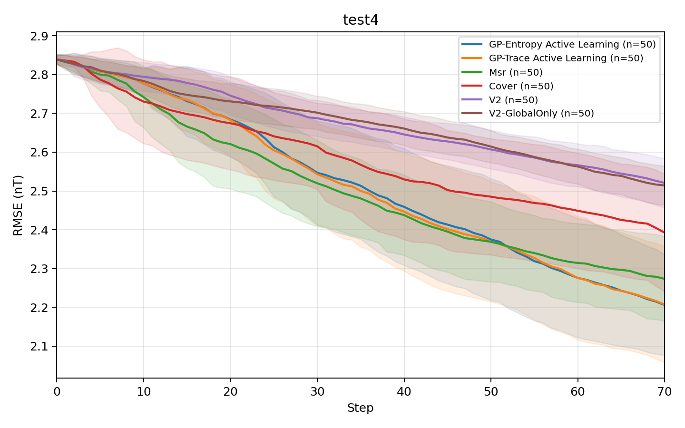

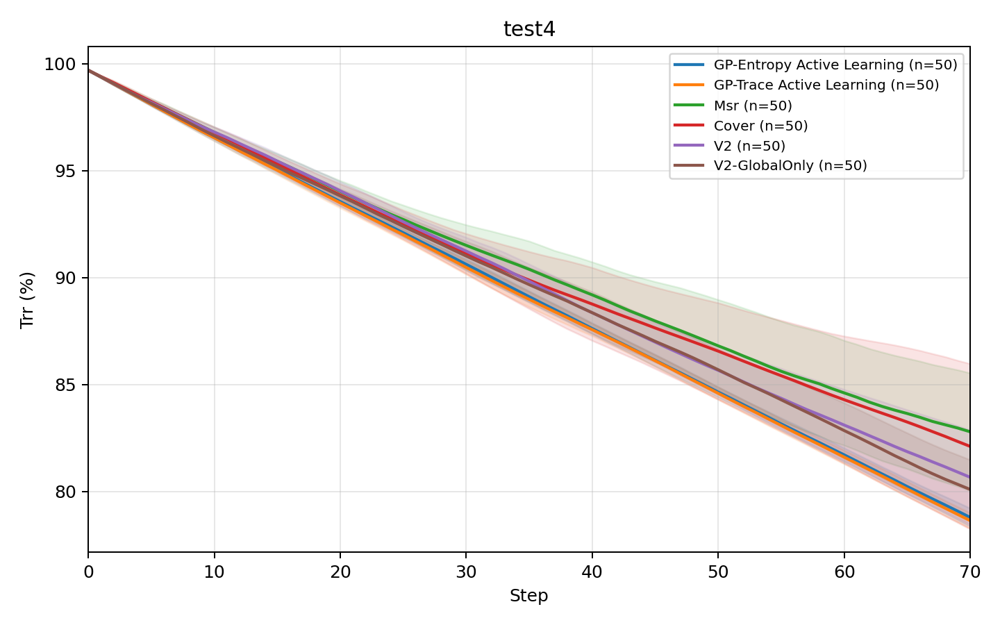

### test5

| 方法                       | 回合数 |        RMSE [nT] |           Trr [%] |
| -------------------------- | -----: | ---------------: | ----------------: |
| GP-Entropy Active Learning |     50 | 5.7072 ± 0.3743 | 58.8197 ± 1.7609 |
| GP-Trace Active Learning   |     50 | 5.6401 ± 0.3656 | 58.3385 ± 1.5768 |
| Msr                        |     50 | 6.4136 ± 0.5588 | 69.5735 ± 5.3050 |
| Cover                      |     50 | 6.2765 ± 1.2115 | 67.8316 ± 7.0712 |
| V2                         |     50 | 5.0673 ± 0.5862 | 60.5462 ± 2.1844 |
| V2-GlobalOnly              |     50 | 4.8955 ± 0.5399 | 58.8154 ± 1.6453 |

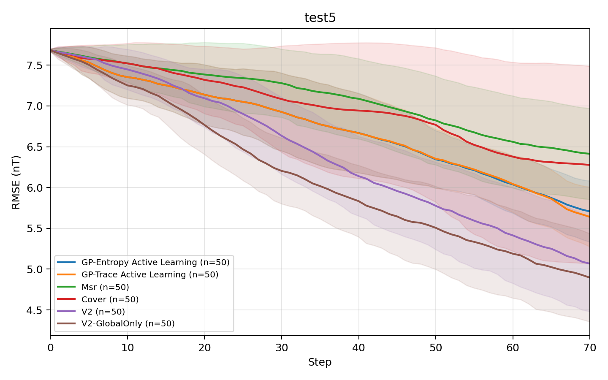

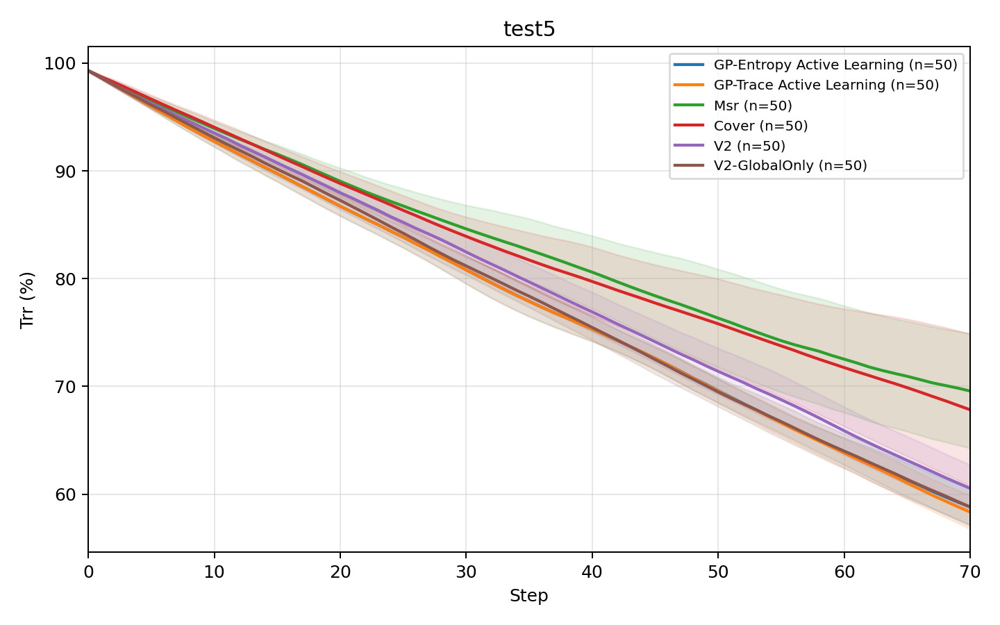

## V3实验：局部原始 Trace 下降奖励（train1）

小实验训练：目的：采用GP_trace——baseline的设计思想，先单独用RL训练一版，看看能不能达到它的效果；V3：单独训练train1这个地图，MDP设计成状态11维度：(x,y,+当前位置的不确定度+八个动作位置的不确定度)，奖励：只用局部r_gp奖励[这里设计的时候，就是计算八个动作的GP_trace差值，用实际动作的trace增量/最大trace增量值，来做归一化]（跟GP_trace这个baseline严格对齐），其他奖励不用，update_epochs=10、训练seed=0/1/2三个seed，PPO γ=0.99，seed 0：10000 回合、每回合 70 步。；

| 方法      |        RMSE (nT) |           Trr (%) |          唯一位置 |             重复 |             越界 |
| --------- | ---------------: | ----------------: | ----------------: | ---------------: | ---------------: |
| gp_trace  | 1.9372 ± 0.5483 | 34.1844 ± 4.2647 | 71.0000 ± 0.0000 | 0.0000 ± 0.0000 | 0.0000 ± 0.0000 |
| v3_seed_0 | 2.8235 ± 0.7034 | 37.2019 ± 5.4592 | 66.2200 ± 4.7341 | 2.8200 ± 2.0168 | 1.9600 ± 3.4926 |

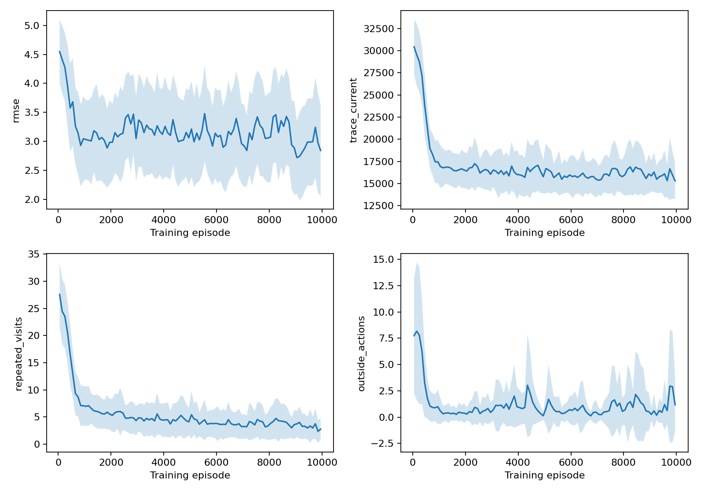

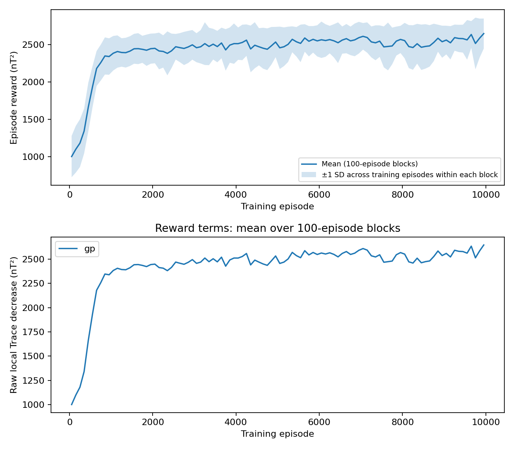

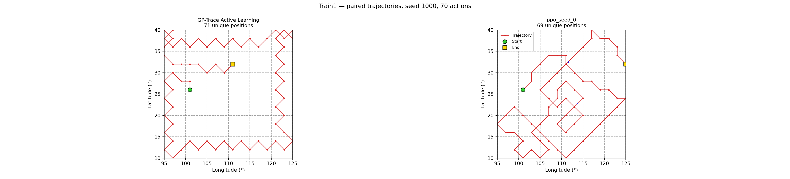

## V3.1实验：基于全局Trace下降的奖励设计

沿用V3的11维状态、动作、GP设置和PPO，1.仅把奖励从“相对局部GP-Trace下降”改为“固定31×31评价网格上的绝对全局GP Trace下降”，2.并将PPO gamma从0.99改为1.0。
**目的**： 验证新奖励能否让PPO更有效地降低最终全局Trace，

### 1. 奖励函数

V3.1采用**未归一化的全局GP Trace下降量**作为奖励：

$$
r_t=\operatorname{Tr}(\Sigma_t)-\operatorname{Tr}(\Sigma_{t+1})
$$

其中，$\Sigma_t$和$\Sigma_{t+1}$分别表示执行动作前后，GP在固定的$31\times31$全局评价网格上的后验协方差矩阵。

同时，将PPO的折扣因子设置为：

$$
\gamma=1
$$

### 2. 累计回报与最终Trace的等价关系

PPO优化的累计折扣回报为：

$$
G_0=\sum_{t=0}^{T-1}\gamma^t r_t
$$

由于$\gamma=1$，代入奖励函数可得：

$$
G_0=\sum_{t=0}^{T-1}
\left[
\operatorname{Tr}(\Sigma_t)-
\operatorname{Tr}(\Sigma_{t+1})
\right]
$$

展开后：

$$
G_0=
\left[\operatorname{Tr}(\Sigma_0)-\operatorname{Tr}(\Sigma_1)\right]
+\left[\operatorname{Tr}(\Sigma_1)-\operatorname{Tr}(\Sigma_2)\right]
+\cdots+
\left[\operatorname{Tr}(\Sigma_{T-1})-\operatorname{Tr}(\Sigma_T)\right]
$$

中间项相互抵消，最终得到：

$$
\boxed{
G_0=\operatorname{Tr}(\Sigma_0)-\operatorname{Tr}(\Sigma_T)
}
$$

需要注意，每个Episode开始时，机器人首先在起点采样一次，该初始采样不计入后续70次动作奖励。因此，$\Sigma_0$表示**完成起点采样后的GP后验协方差矩阵**。

在相同初始状态下，$\operatorname{Tr}(\Sigma_0)$为固定常数。

因此，最大化期望累计回报等价于最小化期望最终GP Trace：

$$
\boxed{
\arg\max_{\pi}\mathbb E_{\pi}[G_0]
=
\arg\min_{\pi}
\mathbb E_{\pi}[\operatorname{Tr}(\Sigma_T)]
}
$$

### 3. V3.1的设计意义

V3.1的主要目的是验证：**当PPO的累计奖励目标与最终全局GP Trace指标一致时，是否能够学习到优于局部GP-Trace贪心基线的路径规划策略。**

### 结果（训练场）

本次 V3.1 的平均 RMSE 和最终 Trace 均优于原 V3 ，但仍未超过 GP-Trace基线。

| 方法       | RMSE (nT)        | 最终 Trace (nT²)       | Trr (%)           | 唯一点            | 重复             | 越界             |
| ---------- | ---------------- | ----------------------- | ----------------- | ----------------- | ---------------- | ---------------- |
| gp_trace   | 1.9372 ± 0.5483 | 14107.0156 ± 1759.9488 | 34.1844 ± 4.2647 | 71.0000 ± 0.0000 | 0.0000 ± 0.0000 | 0.0000 ± 0.0000 |
| v3_seed_0  | 4.2248 ± 0.3725 | 18249.4149 ± 2187.6564 | 44.2223 ± 5.3012 | 65.8200 ± 3.0377 | 4.7800 ± 2.8865 | 0.4000 ± 0.7483 |
| 3.1_seed_0 | 2.7219 ± 0.5688 | 15559.4824 ± 2557.7494 | 37.7040 ± 6.1980 | 66.8600 ± 3.9750 | 4.1400 ± 3.9750 | 0.0000 ± 0.0000 |

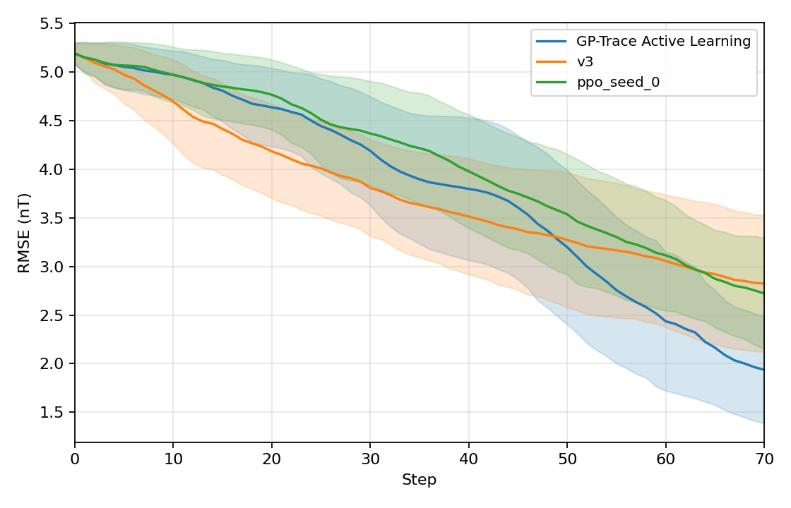

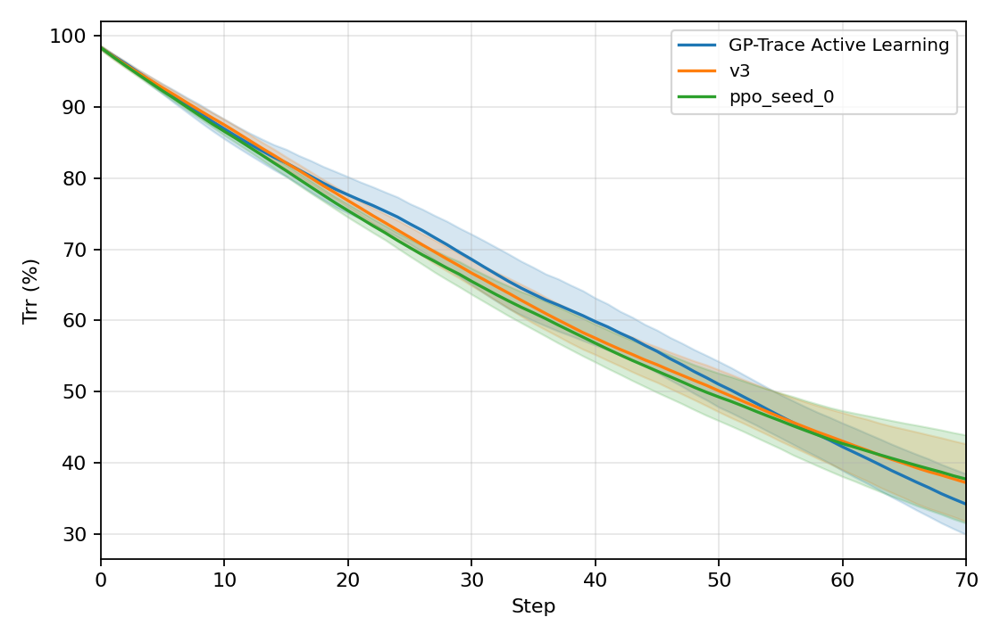

### 结果（测试场）

#### Test2

| 方法            | RMSE (nT)        | 最终 Trace (nT²)       | Trr (%)           | 唯一点            | 重复             | 越界             |
| --------------- | ---------------- | ----------------------- | ----------------- | ----------------- | ---------------- | ---------------- |
| GP-Trace        | 3.2189 ± 0.2605 | 34549.7312 ± 901.8780  | 58.8775 ± 1.5369 | 71.0000 ± 0.0000 | 0.0000 ± 0.0000 | 0.0000 ± 0.0000 |
| V3 local raw    | 3.0720 ± 0.3097 | 36233.4021 ± 1653.3466 | 61.7467 ± 2.8175 | 67.2600 ± 4.3304 | 3.0200 ± 2.1954 | 0.7200 ± 3.5835 |
| V3.1 global raw | 3.3574 ± 0.2983 | 35046.5954 ± 915.2699  | 59.7243 ± 1.5597 | 67.9600 ± 2.2888 | 3.0400 ± 2.2888 | 0.0000 ± 0.0000 |

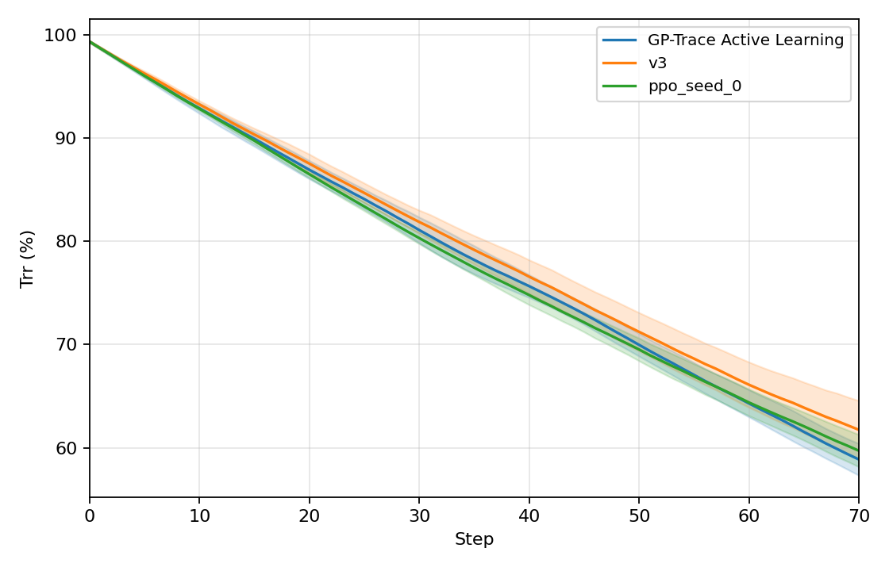

#### Test3

| 方法            | RMSE (nT)        | 最终 Trace (nT²)       | Trr (%)           | 唯一点            | 重复             | 越界             |
| --------------- | ---------------- | ----------------------- | ----------------- | ----------------- | ---------------- | ---------------- |
| GP-Trace        | 3.9712 ± 0.1334 | 89736.2559 ± 351.0552  | 80.2021 ± 0.3138 | 71.0000 ± 0.0000 | 0.0000 ± 0.0000 | 0.0000 ± 0.0000 |
| V3 local raw    | 3.8528 ± 0.1685 | 92488.3347 ± 2385.8329 | 82.6618 ± 2.1323 | 62.1400 ± 7.1833 | 8.2200 ± 6.8477 | 0.6400 ± 2.4229 |
| V3.1 global raw | 3.8294 ± 0.1566 | 90351.7572 ± 979.0024  | 80.7522 ± 0.8750 | 67.1600 ± 3.0024 | 3.8400 ± 3.0024 | 0.0000 ± 0.0000 |

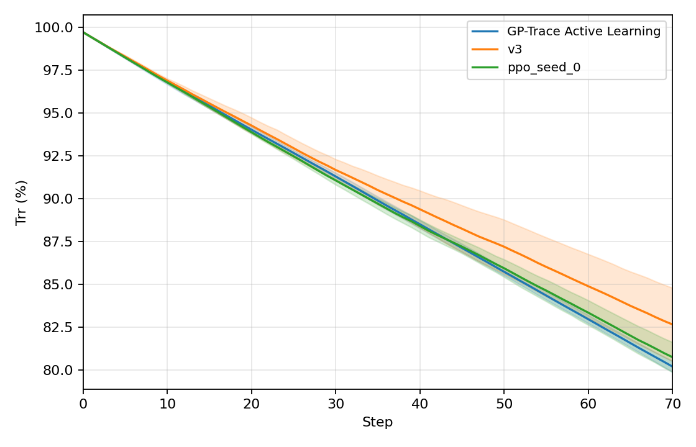

#### Test4

| 方法            | RMSE (nT)        | 最终 Trace (nT²)      | Trr (%)           | 唯一点            | 重复             | 越界             |
| --------------- | ---------------- | ---------------------- | ----------------- | ----------------- | ---------------- | ---------------- |
| GP-Trace        | 2.2073 ± 0.1492 | 33261.0421 ± 156.0247 | 78.6375 ± 0.3689 | 71.0000 ± 0.0000 | 0.0000 ± 0.0000 | 0.0000 ± 0.0000 |
| V3 local raw    | 2.2750 ± 0.1180 | 34407.6319 ± 968.4205 | 81.3483 ± 2.2896 | 62.3800 ± 7.0168 | 7.8400 ± 6.5646 | 0.7800 ± 2.5163 |
| V3.1 global raw | 2.5156 ± 0.0603 | 33578.6907 ± 418.4154 | 79.3885 ± 0.9892 | 66.8600 ± 3.1242 | 4.1400 ± 3.1242 | 0.0000 ± 0.0000 |

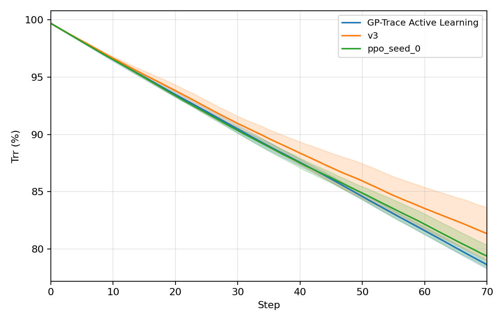

#### Test5

| 方法            | RMSE (nT)        | 最终 Trace (nT²)        | Trr (%)           | 唯一点            | 重复             | 越界             |
| --------------- | ---------------- | ------------------------ | ----------------- | ----------------- | ---------------- | ---------------- |
| GP-Trace        | 5.6401 ± 0.3656 | 121776.8225 ± 3291.3878 | 58.3385 ± 1.5768 | 71.0000 ± 0.0000 | 0.0000 ± 0.0000 | 0.0000 ± 0.0000 |
| V3 local raw    | 5.9173 ± 0.5818 | 128373.6436 ± 6114.2307 | 61.4988 ± 2.9291 | 67.1400 ± 4.2568 | 3.1000 ± 2.0905 | 0.7600 ± 3.5808 |
| V3.1 global raw | 4.9800 ± 0.6091 | 123600.2580 ± 3447.5590 | 59.2121 ± 1.6516 | 67.8400 ± 2.4030 | 3.1600 ± 2.4030 | 0.0000 ± 0.0000 |

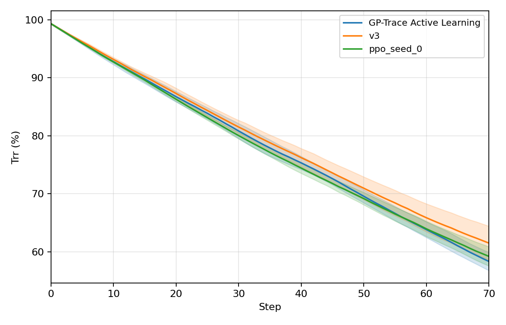

## 很有意义的发现：

**在GP核参数固定的情况下，最终Trace与真实磁场数值无关。 因此，如果你的优化目标是Trace，那么PPO实际上是在学习一个由采样位置决定的确定性规划问题。它并不需要依赖磁场观测值来判断哪条路径的Trace更低。**

本次没有训练策略。Msr、V2、V2-GlobalOnly 均复用原先在祝融训练完成的 seed=0、Episode 10000 模型，没有在 train2～train5 上训练。GP-Entropy、GP-Trace、Cover 使用原算法。每张新地图每方法各测试 50 回合，统一种子 1000～1049，随机起点配对，每回合 70 步。新增 V2 结果仅用训练 seed=0；上面原地图的 V2 两个版本为训练 seed=0/1/2 合计 150 回合，统计口径不同。

网格和在线 GP 协议与原对比一致：16×16 动作网格、31×31 评价网格，在线噪声方差 1e-6，重复位置不重复采样。沿用已知地图先验口径，各地图使用自己的 GP 核参数；V2 两个版本的磁场归一化使用当前地图的正负极值，坐标归一化沿用原 checkpoint，九宫格划分保持不变。Msr 保留原坐标归一化。全局奖励和 Msr 奖励参考量按当前地图计算。

下表为第 70 步 RMSE 和 Trr 的均值±总体标准差（ddof=0），两者越低越好；Trr = trace_current / trace_prior × 100%。曲线为起点采样后的第 0 步至第 70 步均值，阴影为 ±1 个总体标准差。
